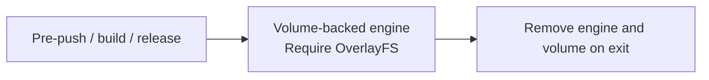
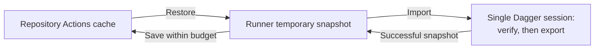

# Pipeline operations

> Standard: Agentic Engineering Standards v1.2.0

## Engine storage

For direct commands, use `bash scripts/with_dagger_engine dagger ...`.

Dagger uses a 20 GB GC target, not a hard quota for active builds. The volume and required OverlayFS prevent full-filesystem snapshot copies.

SIGKILL or Docker failure can leave resources behind. Inspect containers labelled `dagger.ephemeral=true` and their attached volumes before removing idle resources; never remove another active invocation.

## Actions cache

`build.yml` verifies affected PR components and runs all gates on main pushes or manual dispatch. Set the manual `cache` input to false for an uncached comparison. Publication restores trusted main state without saving.

The snapshot contains Coursier, sbt boot, frontend/contract npm downloads, sbt 2's native task store and separate coverage/contract compiler targets. `testFull` reruns every backend test, old measurements are deleted, and the transient scoverage report task computes current-run coverage. Contract generation still executes and compares regenerated outputs; release compilation uses neither coverage nor contract targets. SDK generation and engine layers remain disposable.

Snapshots above 1.5 GB emit a warning and are not saved. All immutable generations share GitHub's free default [10 GB repository allowance](https://docs.github.com/en/actions/concepts/workflows-and-actions/dependency-caching#usage-limits-and-eviction-policy), with native LRU eviction and seven-day idle expiry; paid storage is not enabled. Keys include OS, architecture, month, toolchain/build definitions, both dependency locks and commit SHA. No fallback crosses dependency or monthly generations, so obsolete dependencies stop being restored and expire. Native branch/PR scope isolates untrusted saves from main; concurrent saves of the same key use the first successful upload.

### Measured cost

The full-verification comparison at `16cc46a` includes setup and all cache transfers:

| Measurement | [Uncached control](https://github.com/cosminci/plant-journal/actions/runs/44148198612) | [Cold population](https://github.com/cosminci/plant-journal/actions/runs/44146203079) | [Warm](https://github.com/cosminci/plant-journal/actions/runs/44147276255) | [Warm repeat](https://github.com/cosminci/plant-journal/actions/runs/44149413121) |
| --- | --- | --- | --- | --- |
| Complete build job | 4m58s | 5m30s | 4m36s | 3m11s |
| Full verification step | 4m46s | 5m03s | 4m24s | 2m54s |
| Backend / contract sbt execution | 64s / 36s | 65s / 36s | 25s / 3s | 17s / 2s |
| Actions restore / save | none | <1s / 7s | 5s / no save | 4s / no save |

Both warm runs performed no Scala compilation, but all 274 backend tests and contract regeneration executed with 100% statement/branch coverage. Net job savings were 22-107 seconds against the uncached control; startup variance makes this less predictable than the compiler savings.

The compressed snapshot was 508 MB; warm import/export took about three to five seconds inside verification. These build jobs passed, but the separate shared-guidance job failed on the pre-migration branch; release compilation and publication were not measured.

## Versioning & release provenance

`release-version` generates a UTC calendar-timestamp version (`YYYY.M.D-THHMMSS`) from wall-clock time, not from any git tag; two releases colliding on the same version isn't a real concern — the per-second timestamp already makes it vanishingly unlikely, and GHCR rejects a tag overwrite regardless. `publish` validates that format inline before building or pushing anything. Only after a successful publish does the released commit get an annotated `v<version>` git tag pushed to it — provenance recorded after the fact, never a pre-release gate.

## Publishing

Publish is a manually dispatched workflow, restricted to `main`, that runs full verification (`verify-cached --all`) first; `publish` itself does not run checks. It pushes to the public `ghcr.io/cosminci/plant-journal` package using the GitHub Actions job's own token (`packages: write`), never a personal PAT.

## Deployment

See [`unraid/README.md`](../../unraid/README.md) for NAS deployment, WUD auto-update, and recovery.
