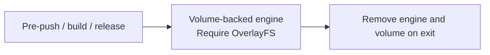

# Pipeline operations

> Standard: Agentic Engineering Standards v1.2.0

## Engine storage

For direct commands, use `bash scripts/with_dagger_engine dagger ...`.

Dagger uses a 20 GB GC target, not a hard quota for active builds. The volume and required OverlayFS prevent full-filesystem snapshot copies.

SIGKILL or Docker failure can leave resources behind. Inspect containers labelled `dagger.ephemeral=true` and their attached volumes before removing idle resources; never remove another active invocation.

## Versioning & release provenance

`release-version` generates a UTC calendar-timestamp version (`YYYY.M.D-THHMMSS`) from wall-clock time, not from any git tag; two releases colliding on the same version isn't a real concern — the per-second timestamp already makes it vanishingly unlikely, and GHCR rejects a tag overwrite regardless. `publish` validates that format inline before building or pushing anything. Only after a successful publish does the released commit get an annotated `v<version>` git tag pushed to it — provenance recorded after the fact, never a pre-release gate.

## Publishing

Publish is a manually dispatched workflow, restricted to `main`, that runs full verification (`verify --all`) first; `publish` itself does not run checks. It pushes to the public `ghcr.io/cosminci/plant-journal` package using the GitHub Actions job's own token (`packages: write`), never a personal PAT.

## Deployment

See [`unraid/README.md`](../../unraid/README.md) for NAS deployment, WUD auto-update, and recovery.
