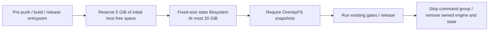

# Pipeline operations

> Standard: Agentic Engineering Standards v1.2.0

## Engine storage

The launcher requires capacity for at least 8 GiB of engine state. A full state filesystem fails the command rather than using more host storage; requiring OverlayFS prevents full-filesystem snapshot copies.

For direct commands, prefix Dagger with `python3 scripts/with_dagger_engine.py`. Pre-push verification and build/publish workflows provision the bounded engine automatically.

Failures print engine diagnostics before cleanup. After an uncatchable termination, inspect `plant-journal-verification` before removing it and its `plant-journal-verification-state` volume; do not remove an active invocation. Concurrent invocations reject the occupied name instead of allocating another disk.

The [retention installer](../../scripts/configure_dagger_engine.py) remains a safeguard for operator-managed default engines. It preserves unrelated user settings and installs the [age/size policy](../../scripts/dagger-engine.json) in Dagger's native configuration directory; existing engines need recreation or restart to read it. Garbage collection cannot reclaim active snapshots and does not provide the bounded launcher's disk quota.

## Versioning & release provenance

`release-version` generates a UTC calendar-timestamp version (`YYYY.M.D-THHMMSS`) from wall-clock time, not from any git tag; two releases colliding on the same version isn't a real concern — the per-second timestamp already makes it vanishingly unlikely, and GHCR rejects a tag overwrite regardless. `publish` validates that format inline before building or pushing anything. Only after a successful publish does the released commit get an annotated `v<version>` git tag pushed to it — provenance recorded after the fact, never a pre-release gate.

## Publishing

Publish is a manually dispatched workflow, restricted to `main`, that runs full verification (`verify --all`) first; `publish` itself does not run checks. It pushes to the public `ghcr.io/cosminci/plant-journal` package using the GitHub Actions job's own token (`packages: write`), never a personal PAT.

## Deployment

See [`unraid/README.md`](../../unraid/README.md) for NAS deployment, WUD auto-update, and recovery.
