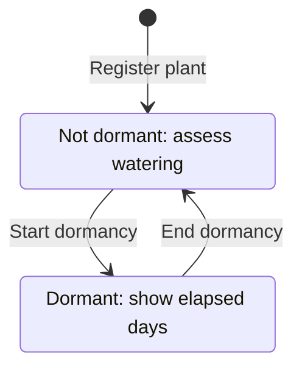
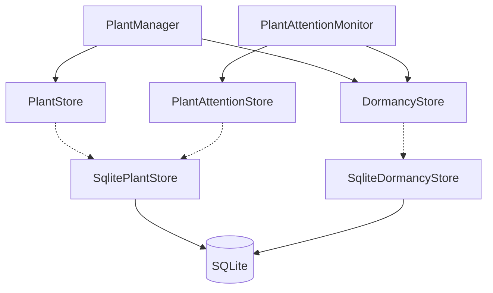

# Plant dormancy

**Classification:** feature

## What and why

Pause watering attention during dormancy without interrupting the care journal.

## Domain



Plants start not dormant at registration. A period with no end date means the plant is currently dormant.

## Scala types

```scala
final case class Plant(id: PlantId, details: PlantDetails, registeredAt: Instant)

opaque type DormancyPeriodId = String
final case class DormancyPeriod(id: DormancyPeriodId, startedAt: Instant, endedAt: Option[Instant])

enum DormancyEdit:
  case Start(since: Instant)
  case End(since: Instant)
  case CorrectDates(periods: NonEmptyList[DormancyPeriod])

trait PlantManager:
  def getDormancyHistory(plant: PlantId): GetDormancyHistoryResult
  def editDormancy(plant: PlantId, edit: DormancyEdit): EditDormancyResult

trait DormancyStore:
  def listPeriods(plant: PlantId): ListDormancyPeriodsResult
  def insertPeriod(plant: PlantId, period: DormancyPeriod): InsertDormancyPeriodResult
  def updatePeriods(plant: PlantId, periods: NonEmptyList[DormancyPeriod]): UpdateDormancyPeriodsResult

final case class AttentionPlant(id: PlantId, registeredAt: Instant)
final case class WateringWindow(maybeFromInclusive: Option[Instant], maybeUntilExclusive: Option[Instant])

trait PlantAttentionStore:
  def listActivePlants(): ListAttentionPlantsResult
  def readWaterings(plant: PlantId, window: WateringWindow, limit: WateringSampleSize): ReadWateringsResult
```

`PlantManager.createPlant` sets `registeredAt` from `Clock` and calls the unchanged `PlantStore.addPlant(plant)`. Under the existing lock, `editDormancy` validates history and uses `IdGenerator` to create a period, closes the open period, or corrects dates by ID. Corrections cannot open or close periods.

`PlantAttentionMonitor` reads periods and skips dormant plants before reading waterings. For other plants it requests non-dormant windows newest first until it fills the sample or runs out of windows. SQLite applies only the supplied bounds and limit. The monitor subtracts dormant time from cadence intervals and elapsed time.

### Factories

```scala
object PlantManager:
  def make(using
      store: PlantStore^, dormancy: DormancyStore^, substrateStore: SubstrateStore^,
      idGen: IdGenerator^, clock: Clock^, lock: PlantUpdateLock^
  )(using log: Logger^, metrics: PlantManagerMetricsApi^)
      : PlantManager^{store, dormancy, substrateStore, idGen, clock, lock, log, metrics}

object PlantAttentionMonitor:
  def make(settings: Settings)(using
      store: PlantAttentionStore^, dormancy: DormancyStore^, clock: Clock^
  )(using log: Logger^, metrics: PlantAttentionMonitorMetricsApi^)
      : PlantAttentionMonitor^{store, dormancy, clock, log, metrics}

object SqliteDormancyStore:
  def make(transactor: Transactor): DormancyStore
```

`Programs.make` keeps its signature. It constructs one `SqliteDormancyStore` and passes it to both use cases. It also passes `SystemClock` to `PlantManager.make`. `SqlitePlantStore.make` still supplies both `PlantStore` and `PlantAttentionStore`.

### Component diagram



Dashed arrows connect ports to their SQLite implementations.

## Contracts

### HTTP and attention feed

| Endpoint | Change |
| --- | --- |
| `GET /plants` | Adds required `registeredAt` to each plant, including archived plants. |
| `GET /plants/{plantId}/dormancy` | Returns `{ periods }` in chronological order. Each period is `{ id, startedAt, endedAt }`. Dates are absolute timestamps; `endedAt` is `null` for an open period. |
| `PATCH /plants/{plantId}/dormancy` | Accepts `{ kind: "start" \| "end", since }` or `{ kind: "correctDates", periods: [{ id, startedAt, endedAt }] }`. Returns the saved `{ periods }`. An invalid edit returns `422`. |
| `GET /attention` and `/attention/feed` | Keep `{ plantId, watering }` unchanged. Complete snapshots omit dormant plants. Each snapshot replaces the previous one, so omitted entries do not linger. |

The garden joins the plant catalog, dormancy history, and watering attention by plant ID. **Edit plant** sends dormancy changes via `PATCH`; the garden uses the returned history immediately and hides cached watering attention while the plant is dormant. Missing attention does not imply dormancy.

A successful dormancy save requests an attention refresh. If refresh fails, the save stands and the feed keeps the last complete projection.

### SQLite

**Flyway: `V3__plant_dormancy.sql`**

```sql
alter table plant add column registered_at text;

create table dormancy_period (
    id text not null primary key,
    plant_id text not null references plant(id),
    started_at text not null,
    ended_at text
) strict;

create index dormancy_period_plant_started_idx on dormancy_period (plant_id, started_at);

alter table operation add column is_watering integer
    check (is_watering in (0, 1));

create index operation_watering_plant_date_id_idx
    on operation (plant_id, date desc, id desc) where is_watering = 1;
```

Scala determines whether an operation includes watering from its typed actions. The operation adapter stores that value with the payload on inserts and edits. Attention reads by the stored flag and supplied date bounds. The existing index still serves journal pagination.

**One-time backfill: run against the NAS SQLite database after Flyway, before starting the updated app.**

```sql
begin;

update plant
set registered_at = coalesce(
    (select min(date) from operation where plant_id = plant.id),
    strftime('%Y-%m-%dT%H:%M:%f000000Z', 'now')
)
where registered_at is null;

update operation
set is_watering = (
    kind = 'Care' and exists (
        select 1 from json_each(operation.payload, '$.actions')
        where value = 'Watered'
    )
)
where is_watering is null;

commit;
```

`registered_at` is nullable for the manual backfill; a missing timestamp after backfill is a read error. The adapter updates a batch of period dates in one transaction.

## Acceptance

- **Garden.** Zzz is a labeled status indicator, not a button. It is gray when the plant is not dormant. During dormancy, a colored Zzz and the number of full days since dormancy began replace watering attention.

- **Edit plant.** Start or end dormancy at a chosen date and time, or correct either date of any recorded period. Dates must stay in order and cannot be in the future. Periods can touch but cannot overlap. Invalid edits save nothing and keep the draft visible with an error.

- **Initial date.** A new plant starts outside dormancy at creation. The operator seeds existing plants with their earliest recorded operation, or the seed time if there are no operations. No dormancy date can precede this fixed starting point.

- **Watering attention.** Care and repot operations can still be logged. Attention skips dormant plants. When dormancy ends, attention resumes using waterings outside dormant periods and counts only time outside those periods. A watering at the start is excluded; one at the end counts. Date corrections recalculate attention without changing the journal.

- **Archive.** Move **Move to cemetery** from the card to **Edit plant**. Keep the existing confirmation. Cancel returns focus to the archive action and preserves the draft. Confirming archives the plant without saving draft edits.

- **Cemetery.** Show `registeredAt` as the birth date instead of the first operation date. Keep the last operation date as the end date; if there are no operations, show only the birth date.

## Doc Sync

| Document / section | Required edit |
| --- | --- |
| `design.md` / Domain model | Add the plant's dormancy history and show how it limits watering attention without changing operation history. |
| `design.md` / Use cases and workflows | Show the three-way garden join, the dormancy edit path, and the cemetery's registration-based birth date. |
| `design.md` / Architecture | Add the component diagram showing the shared dormancy port and wiring. |
| Contracts / WebSocket attention feed | Document that watering snapshots omit dormant plants. |
